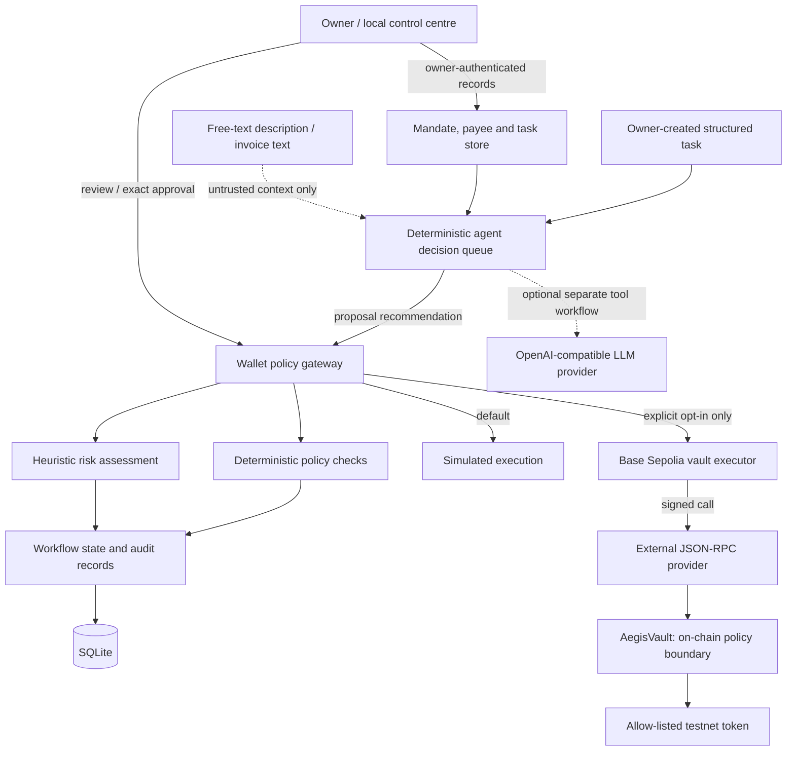

# FinTechathon submission close-out kit

**Status:** Working submission material for review and rehearsal. This is not an independent security audit, a production-readiness assessment, or proof of live deployment.

This document consolidates the technical story, security boundaries, demo narration, presentation timing, business case, and evidence checklist for Aegis Agent Wallet. Replace any bracketed placeholders with real operator-generated values before submission. Do not imply that a planned check or illustrative scenario has already happened.

## 1. The story in one minute

Aegis explores how an AI agent can prepare payment proposals without being granted unrestricted authority over a wallet. The owner creates structured mandates, payees, and payment tasks. The agent makes deterministic, mandate-bounded recommendations and sends any proposal through the existing wallet policy gateway. The owner remains responsible for governance and approval; a hard policy block cannot be overridden by approval. Execution is simulated by default. The only supported real-transfer path is an explicitly enabled, unaudited AegisVault on Base Sepolia (chain ID 84532), which independently enforces vault-side limits and recipient/approval rules.

The prototype focuses on a specific design question: **how do we make an agent useful without making its judgement the security boundary?** It combines constrained inputs, deterministic policy, persisted state, explicit owner review, audit evidence, repeatable adversarial evaluation, and verification tooling. It does not claim that an LLM is generally safe, that a payee is independently identity-verified, or that a hash proves the truth of a report.

## 2. Architecture and data flow

### Walkthrough of the trust boundaries

1. **Owner input:** The owner manages the mandate, payee records, and structured task. A payee marked `verified` is owner-attested; the label is not an independent identity check.
2. **Agent decision:** The persisted governance queue is deterministic. Free-text task descriptions are display context, not the source of recipient, token, chain, or amount. The optional LLM tool workflow is separate and has not been integrated as the reasoner over the persisted queue.
3. **Policy gateway:** A recommendation becomes a proposal only through the existing wallet controller. The policy engine and heuristic risk engine evaluate the proposal; a hard policy block cannot be overridden by approval.
4. **Owner control:** The agent cannot approve/reject, change the owner policy, alter mandates or payees, or operate the pause/resume controls. Approval is owner-authenticated and bound to the exact proposal fingerprint with an expiry.
5. **Persistence:** SQLite stores workflow/governance records and audit events. Hashes and hash chains help detect inconsistencies, but they are not signatures and cannot stop an attacker who can rewrite the entire database and recompute hashes.
6. **Execution:** Simulation is the default. Real transfers are limited to the explicit Base Sepolia vault path. The contract is unaudited and must not be used for real funds or mainnet.
7. **External services:** RPC and market-data providers are outside the local trust boundary. Readable token metadata does not prove token authenticity; an RPC observation is not an independent consensus proof or guarantee of finality.

## 3. Security summary for judges

| Security objective | Implemented control | Important limitation |
|---|---|---|
| Keep payment fields grounded in owner data | Structured task/payee records; free text cannot override recipient, token, chain, or amount | Correctness of owner-entered data and out-of-band payee checks remains the owner's responsibility |
| Prevent the agent from self-authorising | Separate agent/owner bearer-token roles; agent cannot approve or change governance | Bearer tokens are development credentials, not a production identity system |
| Enforce policy before a proposal proceeds | Deterministic allowlists, amount/spend limits, recipient-specific rules, hard blocks, and risk checks | Risk scoring is heuristic; the demo policy is not a user-specific policy |
| Bind approval to the proposal | Exact stored fingerprint and expiring owner approval; stale approval is invalidated | A compromised owner token can approve; fingerprint checks are not signatures |
| Limit vault-mode impact | Separate agent session key; AegisVault enforces token, recipient, cap, approval, and pause rules | Contract and dependencies are unaudited; a compromised agent can still spend within permitted limits or use an existing exact approval |
| Preserve useful audit evidence | Persisted workflow/governance events, hash checks, evidence bundle validation, and artifact manifest | A hash is not proof of authorship or truth; a database owner can rewrite the whole database |
| Make evaluation repeatable | Deterministic scenario suite, repeated-run aggregation, optional LLM injection cases, bundle and manifest verification | Offline scenarios are bounded regression coverage, not proof of general LLM safety or live-chain behaviour |
| Avoid accidental mainnet execution | Simulation by default; actual-transfer mode restricted to Base Sepolia chain ID 84532 | Operator configuration and throwaway testnet keys still require care |

### Explicit non-claims

Aegis does **not** claim to provide production key custody, a certified identity system, a validated fraud detector, general prompt-injection immunity, a security audit, a live-chain finality guarantee, or mainnet readiness. The local available-balance field in the mandate is owner-maintained planning data, not a live on-chain balance. Governance budget reconciliation reads local persisted workflow statuses; it is not chain-observed settlement reconciliation.

## 4. Ten-minute presentation talk track

Use this as a timed rehearsal plan rather than a script that must be read word for word. Keep the live demo in simulation mode unless a separately prepared Base Sepolia testnet demonstration is required and safely configured.

| Time | Section | What to say / show |
|---|---|---|
| 0:00–0:45 | Problem | Agents can automate repetitive payment preparation, but unrestricted wallet authority turns a bad instruction or compromised agent into a funds-control problem. |
| 0:45–1:30 | Design principle | Aegis separates recommendation from authorisation: owner-managed structured tasks, deterministic policy, owner approval, and an independent vault boundary in the optional testnet path. |
| 1:30–2:30 | Architecture | Walk through the diagram: owner records → decision queue → policy gateway → persisted workflow → simulated execution or Base Sepolia vault. Emphasise that free text is not payment authority. |
| 2:30–4:30 | Live demo: normal case | Create or inspect an owner-managed mandate/payee/task, run the deterministic queue, and show the resulting recommendation and policy-gateway proposal. Use a small amount and simulated mode. |
| 4:30–5:45 | Live demo: guardrails | Show an unknown/unverified payee or policy violation. Explain why the task escalates or is blocked, and why an owner approval cannot override a hard block. |
| 5:45–6:45 | Governance and audit | Show the persisted decision, task/proposal linkage, audit verification, and budget reservation lifecycle. Clarify that local audit hashes are tamper-evident consistency checks, not signatures. |
| 6:45–7:45 | Evaluation | Show the deterministic evaluation report and repeated-run result generated from the source revision being submitted. Explain the tested scenario inventory and its limits. |
| 7:45–8:45 | Testnet boundary | Describe the optional Base Sepolia vault path and evidence verifier. Only show a real transaction if the operator has genuinely executed it and verified the exact evidence. Otherwise say live evidence is pending and show the verification workflow. |
| 8:45–9:30 | Business value | Position Aegis as a reference architecture for controlled agent-initiated payment workflows: automate preparation, keep policy enforcement deterministic, and leave authorisation with the owner. |
| 9:30–10:00 | Close | Summarise the principle: the agent can recommend and prepare, but cannot grant itself authority. Name the next steps: independent security review, stronger operational identity/key management, and verified testnet evidence. |

### Suggested opening

“An AI agent can prepare a payment faster than a human can navigate every form. But speed is not the same as authority. Aegis is a prototype for letting an agent prepare a payment while keeping the rules, approval, and final execution boundaries explicit and independently enforced.”

### Suggested closing

“Our goal is not to trust the agent more. It is to make the system depend less on trusting the agent. The current prototype demonstrates a constrained workflow and repeatable checks; production deployment would require independent security review, stronger identity and key management, and operational evidence beyond offline tests.”

## 5. Ninety-second demo video script

**0–12 seconds — Problem and thesis**  
Narration: “Agentic payments need more than a capable model. They need clear limits on what the model can decide and what it can actually authorise.”  
Visual: Aegis landing page and a simple owner → agent → policy gateway diagram.

**12–28 seconds — Owner-defined intent**  
Narration: “The owner creates the mandate, registers a payee, and submits a structured payment task. Free text is context; it cannot replace the authorised payment fields.”  
Visual: Governance view showing a mandate, payee, and task. Use sanitised demo data only.

**28–45 seconds — Decision and policy**  
Narration: “The deterministic queue evaluates the task and routes any proposal through the existing policy gateway. The agent cannot approve itself, and hard policy blocks remain hard blocks.”  
Visual: Decision rationale and proposal status. Do not show tokens, secrets, or private environment values.

**45–62 seconds — Guardrail**  
Narration: “An unverified payee or policy violation escalates or blocks the task. Owner review remains explicit, and approval is bound to the exact proposal.”  
Visual: Show a blocked or awaiting-approval case and its reason.

**62–77 seconds — Evidence**  
Narration: “We can repeat the offline scenarios and verify the resulting evidence bundle and artifact hashes. These checks support reproducibility; they are not a security audit or proof of live-chain execution.”  
Visual: Show successful evaluation and verification commands/results from the actual run being submitted.

**77–90 seconds — Close**  
Narration: “Execution is simulated by default. The optional real-transfer path is limited to an unaudited Base Sepolia vault. Aegis demonstrates the principle: let the agent prepare, but do not let it define its own authority.”  
Visual: Show the trust-boundary diagram and the Base Sepolia/testnet-only label.

## 6. One-page business case for WeBank / agent-wallet stakeholders

### A controlled execution layer for AI-initiated payment workflows

**Opportunity.** AI agents can help prepare repetitive, rule-bound payment workflows, but giving a model direct and broad wallet authority creates an avoidable control problem. Financial institutions and enterprise platforms need a clear boundary between an agent's recommendation and the system's authority to approve or execute a payment.

**Proposed approach.** Aegis is a testnet-focused reference prototype that separates those responsibilities. Owners define structured mandates, payees, and tasks. A deterministic decision queue evaluates those records, while a wallet policy gateway applies allowlists, caps, risk checks, and approval requirements. Owner approval remains separate from agent recommendation. The optional AegisVault adds a second policy boundary for testnet transfers.

**Potential value.**
- **Bounded automation:** automate payment preparation without granting the agent authority to edit its own mandate or approve its own proposal.
- **Policy clarity:** make the key constraints explicit and testable rather than burying them in a prompt.
- **Reviewability:** persist decisions and workflow transitions so an operator can inspect why a task escalated, was blocked, or produced a proposal.
- **Reproducibility:** rerun deterministic scenarios and validate selected evidence files before sharing a submission.
- **Incremental integration path:** treat the prototype as a design and evaluation starting point, not as a drop-in custody or banking system.

**Illustrative target workflows.** Subject to institution-specific requirements and independent validation, the design could inform internal invoice preparation, scheduled supplier-payment proposals, treasury-operation queues, or controlled disbursement workflows. These are candidate use cases, not integrations or deployments already delivered by this prototype.

**What is demonstrated today.** A local Python/FastAPI application, SQLite-backed workflow and governance records, deterministic mandate-bounded decisions, a constrained agent interface, owner review, simulation-first execution, a testnet-only vault integration, offline adversarial regression scenarios, and evidence verification tooling.

**What is not yet demonstrated.** Production identity and role management, institutional custody, independent security audit, production-scale reliability, regulatory compliance, live banking integrations, verified real-world payee identity, or safe mainnet execution. The vault is unaudited and must not hold real funds.

**Suggested next step.** Run a scoped design-partner evaluation using synthetic payment data and simulation mode; agree on threat model, approval responsibilities, audit/export requirements, and success metrics before considering any real integration. Any testnet trial should use throwaway keys, independently verified addresses, and a documented rollback/incident plan.

## 7. Evidence and submission checklist

Mark each item only after inspecting the actual artefact. “Generated” does not automatically mean “passed” or “live”.

### Source and automated checks

- [ ] Record the exact Git commit SHA used to generate the submission reports.
- [ ] Run `uv run --locked ruff check .`.
- [ ] Run `uv run --locked python -m pytest -q`.
- [ ] If Solidity changes are part of the submission, run the Foundry suite from `contracts/` and retain its output.
- [ ] Run `uv run --locked python -m agent.eval --output-dir reports/submission/agent-eval`.
- [ ] Run `uv run --locked python -m agent.repeated_eval --runs 5 --output-dir reports/submission/repeated-eval`.
- [ ] Review the scenario inventory, failures, and limitations; do not report only the aggregate pass count.
- [ ] If running optional LLM injection tests, label provider/model/configuration and keep those results separate from deterministic offline evidence.

### Evidence integrity

- [ ] Build the evidence bundle with `scripts.build_evidence_bundle`.
- [ ] Verify it with `scripts.verify_evidence_bundle` and inspect the report contents.
- [ ] Build a manifest of the exact JSON/Markdown files intended for submission.
- [ ] Verify the manifest and confirm the tracked source tree state is appropriate for the reported revision.
- [ ] Rebuild and reverify the manifest after any artifact is regenerated or edited.
- [ ] Keep raw outputs and their source revision together; do not edit a passing report to make it read better without rerunning verification.

### Optional live Base Sepolia evidence

- [ ] Confirm the target is Base Sepolia, chain ID `84532`, and use throwaway testnet wallets only.
- [ ] Verify the actual deployed vault address, deployment transaction, owner, runtime bytecode fingerprint, and confirmation threshold.
- [ ] For a successful transfer, verify the actual transaction receipt, sender, vault call, token transfer event, audit linkage, and confirmation depth.
- [ ] If including a reverted call, verify its mined receipt status and label it as a failed call—not a successful transfer.
- [ ] Run cross-artifact deployment/transfer verification and live re-verification where applicable.
- [ ] Preserve exact transaction hashes, public addresses, tool output, and report files. Do not include private keys, bearer tokens, RPC credentials, or secret-bearing environment files.
- [ ] If no genuine live evidence exists, state plainly that live evidence is pending. Do not substitute fixtures, simulations, or invented hashes.

### Presentation and packaging

- [ ] Rehearse the ten-minute talk and record which demo steps are reliable.
- [ ] Record the 90-second video from the actual current build; blur/redact secrets and personal data.
- [ ] Replace any illustrative data with sanitised, clearly labelled demo data.
- [ ] Confirm all diagrams, reports, and claims match the exact code revision being submitted.
- [ ] Include limitations and future work; do not claim audit, production readiness, real-world deployment, or general LLM safety.
- [ ] Package the manifest, the selected artefacts, the source revision, the demo script, and the presentation notes together.

## 8. Residual risks and next engineering steps

1. **Independent review:** commission code and contract security review before any production or real-fund use.
2. **Identity and key management:** replace development bearer-token assumptions with an institution-grade identity, role, secret rotation, and custody design.
3. **On-chain operational evidence:** capture genuine Base Sepolia deployment/transfer/revert evidence and re-verify it from a trusted independent source.
4. **Receipt/finality reconciliation:** reconcile persisted workflow state with confirmed chain receipts and explicitly handle uncertain submission outcomes.
5. **LLM and data provenance:** integrate any future LLM reasoning over persisted tasks only behind strict structured-output validation, policy checks, source provenance, and adversarial evaluation.
6. **Operational resilience:** test backup/restore, migration recovery, deployment isolation, monitoring, and incident response.
7. **Evidence provenance:** preserve exact revisions and report hashes while recognising that local hashes are not signatures or trusted timestamps.

## 9. Related repository guides

- [Threat model](threat-model.md)
- [Security self-assessment](security-self-assessment.md)
- [Technical document](technical-document.md)
- [Phase 5 hardening and testnet evidence runbook](phase-5-hardening.md)
- [Reproducible submission evidence and manifest](submission-evidence.md)
- [Adversarial evaluation matrix](adversarial-evaluation.md)
- [Reproducible demo scenario](demo-scenario.md)
- [Mandate-driven agent decisions](mandate-driven-agent.md)
