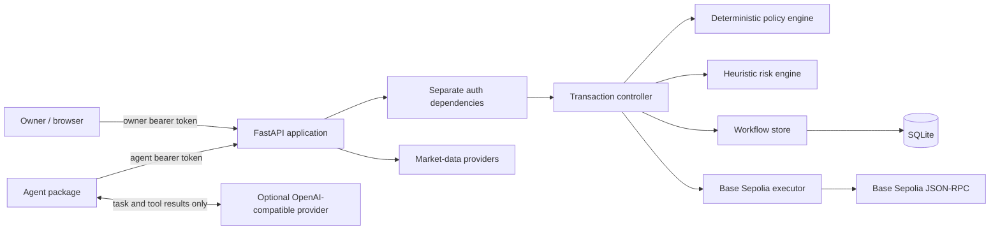

# Aegis Agent Wallet — Technical Document (Draft)

**Document status:** Draft for review. This describes the prototype as implemented;
it is not a production deployment specification or a security certification.

## 1. Purpose and scope

Aegis is a local-first, testnet-focused wallet-agent prototype. It accepts payment
proposals from an agent, evaluates them against deterministic policy and heuristic
risk rules, records workflow state in SQLite, and exposes owner-authenticated
approval and execution operations. Execution is simulated by default. An explicitly
configured mode can sign and submit allowlisted ERC-20 transfers on Base Sepolia
(chain ID `84532`) only.

The agent can propose transactions, retrieve market quotes, and read a limited
transaction status. It cannot approve, reject, execute, or broadcast a transaction.
No mainnet execution, exchange or broker order routing, or production key custody is
provided.

## 2. Architecture



### Components

- **`app/main.py`** defines the FastAPI routes, request/response schemas, demo policy,
  request logging, and dependency wiring. It serves the dependency-free frontend at
  `/`.
- **`app/auth.py`** provides separate agent and owner bearer-token dependencies.
  Protected workflow routes fail closed when required token configuration is
  missing or the configured tokens are identical. Token comparisons use
  `hmac.compare_digest`.
- **`app/policy/`** evaluates allowed chain, token, trusted token metadata, recipient,
  transaction amount, daily spend, and recipient-specific limits. Hard blocks
  cannot be overridden by owner approval.
- **`app/risk/`** calculates a deterministic, explainable heuristic score. It is
  not a fraud detector and is distinct from policy enforcement.
- **`app/workflow/controller.py`** coordinates proposal evaluation, approval, and
  execution.
- **`app/workflow/store.py`** persists proposals and audit events in SQLite. It
  performs spending reservations and state changes under database transactions.
  Audit rows have SQLite guards against ordinary update and delete operations;
  these are not cryptographic tamper protection against someone controlling the
  database file.
- **`app/chain/`** contains read-only Base Sepolia inspection and a separately gated
  executor. In testnet mode, `eth-account` signs locally; the executor sends signed
  bytes to the configured RPC provider, not the private key.
- **`agent/`** provides the agent-token-only API client, a constrained tool loop for
  an optional OpenAI-compatible LLM, a deterministic offline fallback, and
  `python -m agent.eval`.
- **`frontend/index.html`** is a same-origin local control centre; it has no
  frontend package dependency.
- **Market-data providers** supply informational quote reads. Quotes are not
  transaction authorization or investment advice.

### Demo policy

The checked-in demo policy allows Base Sepolia USDC (six decimals), with a maximum
single transaction of `50,000,000` base units and a daily limit of
`150,000,000` base units. For this token, these correspond to 50 USDC and 150 USDC.
The approval threshold is also 50 USDC. The policy names two placeholder recipients;
an unknown recipient requires approval. The code and frontend are configured for a
demonstration and must not be mistaken for a user-specific wallet policy.

## 3. Principal request flows

### Agent proposal

1. The agent receives task data containing a structured `authorized_payment`.
   Free-form invoice text is untrusted context and is not the source of payment
   parameters.
2. The offline agent proposes that structured payment directly. In LLM mode, each
   proposal tool call must match the structured payment before it can reach the
   API.
3. `POST /transactions/propose` authenticates with the agent token. The workflow
   checks the persisted same-day spend, evaluates policy and risk, creates a
   proposal fingerprint, reserves budget when applicable, and records the result.
4. The response is `ready`, `awaiting_approval`, or `blocked`. A `ready` response is
   only a proposal; it is not an executed transfer.

The agent also has agent-token access to
`GET /agent/market-data/{asset_class}/{symbol}` and
`GET /agent/transactions/{transaction_id}`. The latter returns limited status,
execution reference, and update time, not the full proposal or audit history.

### Owner review and execution

1. The owner uses the owner token to read the proposal and its audit trail.
2. If approval is required, `POST /transactions/{transaction_id}/approve` requires
   the exact proposal fingerprint and explicit `APPROVE` confirmation. Approval
   expires after `AEGIS_APPROVAL_EXPIRES_SECONDS` (default 300 seconds).
3. `POST /transactions/{transaction_id}/execute` is owner-only. It revalidates
   proposal integrity, policy, spend, risk, and approval state immediately before
   execution. A hard policy block cannot be approved through.
4. In default `simulated` mode, the workflow records simulated execution without
   signing or sending a transaction.
5. In `base_sepolia` mode, the executor validates the allowlisted token and chain,
   estimates gas, applies configured gas caps, signs locally, and records the
   signed transaction before broadcast. An uncertain submission retries the same
   signed bytes rather than choosing a new nonce.
6. `GET /transactions/{transaction_id}/receipt` is owner-only and reports
   `pending`, `success`, or `failed` for a submitted testnet transaction. Submission
   or a successful receipt response is not proof of finality.

The owner can also reject or cancel a pending proposal. Either action releases its
daily reservation. Idempotency keys on proposals prevent an identical retry from
creating a second reservation and reject reuse with a different proposal.

### Other API surfaces

| API surface | Access | Purpose and boundary |
| --- | --- | --- |
| `GET /health` | No bearer token | Process status and selected execution mode; not a database or RPC readiness check. |
| `POST /policy/evaluate`, `POST /risk/assess` | No bearer token | Demo evaluation using caller-supplied spend; does not create workflow state and is not execution authorization. |
| `GET /transactions`, `/transactions/{id}`, `/transactions/{id}/audit` | Owner token | Full transaction and audit reads. |
| `POST /transactions/{id}/approve`, `/reject`, `/cancel`, `/execute` | Owner token | Owner workflow actions; execution is subject to current mode and revalidation. |
| `GET /chain/base-sepolia/status`, `/chain/base-sepolia/token/{address}` | Owner token | Read-only chain inspection. |
| `GET /market-data/{asset_class}/{symbol}` | Owner token | Validated market quote read. |

The unauthenticated evaluation endpoints expose a policy oracle. They are intended
for controlled local demonstration and should not be exposed to untrusted callers.

## 4. Safety model and trust boundaries

- **Separation of authority:** the agent token is limited to proposals and limited
  reads. Owner-only operations use a distinct token. The agent does not load or
  disclose the owner token.
- **Human control:** the agent does not approve or execute. Owner-authenticated
  execution is always required, including for a proposal in `ready` state; explicit
  approval is additionally required when policy or risk demands it.
- **Policy before action:** policy hard blocks, bounded amounts, trusted token
  metadata, recipient rules, daily reservations, and execution-time reevaluation
  constrain what may execute. Risk is heuristic and cannot override policy.
- **Approval integrity:** approval is tied to a proposal fingerprint and expires.
  Fingerprinting detects inconsistent stored proposal data but is not a signature
  and does not protect against an attacker who controls the application or database.
- **Accounting and audit:** SQLite serializes relevant workflow updates and tracks
  active reservations. State-changing transitions append audit events in the same
  transaction. Direct database-file access is outside the protection offered by
  the audit triggers.
- **Testnet boundary:** simulated execution is the default. Testnet execution must
  be explicitly selected, requires a throwaway key and HTTPS RPC URL, and rejects
  any chain other than Base Sepolia `84532`. The private key is loaded from the
  process environment and is not returned or logged. The host and persisted signed
  transaction bytes remain sensitive.
- **LLM boundary:** the optional LLM provider receives task content and tool
  results, but not either Aegis bearer token. A structured-payment match check
  prevents a tool call from changing those fields; it does not establish that the
  structured payment was independently verified or that all prompt injection is
  defeated.
- **External services:** market and RPC provider output is untrusted. Provider
  availability, token authenticity, recipient identity, and transaction finality
  are not guaranteed by this prototype.

For additional security detail and residual risks, see the
[threat model](threat-model.md), [workflow transitions](workflow-state-transitions.md),
[runtime configuration](runtime-configuration.md), and [agent guide](agent.md).

## 5. Local deployment and operation

This is a local development deployment procedure, not production hardening guidance.
Keep the API bound to loopback. Do not expose it publicly or use real-fund keys.

1. Install Python 3.11 or later and `uv`. From the repository root, install the
   locked dependencies:

   ```bash
   uv sync --locked --extra dev
   ```

2. Generate distinct local bearer tokens and select a database path:

   ```bash
   export AEGIS_AGENT_TOKEN="$(python -c 'import secrets; print(secrets.token_urlsafe(32))')"
   export AEGIS_APPROVAL_TOKEN="$(python -c 'import secrets; print(secrets.token_urlsafe(32))')"
   export AEGIS_DB_PATH="./aegis-workflow.sqlite3"
   export AEGIS_APPROVAL_EXPIRES_SECONDS="300"
   ```

   Keep the tokens out of source control, screenshots, and logs. Protect the SQLite
   file and backups. The default mode is `simulated`; do not configure a private key
   for normal local simulation.

3. Run the automated checks and deterministic offline agent evaluation:

   ```bash
   uv run --locked ruff check .
   uv run --locked pytest
   uv run --locked python -m agent.eval
   ```

   The evaluation uses temporary databases and does not require an API key, live
   RPC, market-data provider, or LLM service.

4. Start the application on loopback:

   ```bash
   uv run --locked uvicorn app.main:app --host 127.0.0.1 --port 8000
   ```

   Open `http://127.0.0.1:8000/` for the frontend or
   `http://127.0.0.1:8000/docs` for the API schema. `/health` reports the process
   status and selected execution mode only.

5. To run the agent locally, set `AEGIS_API_URL` (default
   `http://127.0.0.1:8000`) and `AEGIS_AGENT_TOKEN`. Leave all three LLM settings
   unset for the offline fallback. To use a compatible provider, configure
   `AEGIS_LLM_BASE_URL`, `AEGIS_LLM_MODEL`, and `AEGIS_LLM_API_KEY` together. The
   provider URL must use HTTPS except for loopback development; do not include
   credentials in the URL.

### Optional Base Sepolia manual test

Only use a throwaway wallet funded with Base Sepolia faucet assets. Follow the
[manual test procedure](runtime-configuration.md#manual-base-sepolia-test-transfer)
for explicit `base_sepolia` configuration, a small owner-reviewed transfer, receipt
inspection, and key cleanup. No live transfer is claimed by this document.

- **TODO:** After performing and independently checking a test transfer, record its
  Base Sepolia transaction hash and the observed receipt result here:
  `TODO — no testnet transaction hash has been supplied or verified.`
- **TODO:** Record the date, RPC provider (without credentials), and reviewer for
  that manual validation.

## 6. Known limitations

- The authentication scheme is static development bearer tokens, not an identity
  provider, production authorization system, or token rotation service.
- The configured demo policy and placeholder recipients are not a wallet setup
  workflow for real users.
- The risk score is a heuristic, not validated fraud detection.
- Structured payment data is not independently verified by the agent.
- SQLite and its append-only triggers do not provide cryptographic audit integrity
  against database-file control.
- There is no production key custody, hardware signer, multi-party approval, chain
  reorganization handling, finality tracking, balance reconciliation, or automated
  recovery process.
- The project is not a broker, exchange, or investment-advice service.
