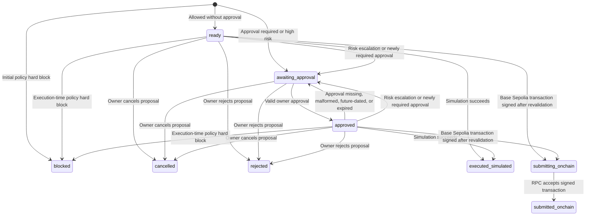

# Workflow State-Transition Table

This document describes the state transitions implemented by `TransactionController` and `WorkflowStore`. Simulated execution is the default; `submitted_onchain` is used only when Base Sepolia execution is explicitly enabled.

## State-transition diagram

The diagram summarizes the state-changing paths in the table below. Rejected and idempotent operations leave the stored status unchanged; they are listed separately because they are not state transitions.

`cancelled`, `rejected`, `executed_simulated`, and `submitted_onchain` are terminal workflow states. Cancelling or rejecting releases the proposal's daily spend reservation. Repeating a rejection leaves the record unchanged and returns its current state. `submitting_onchain` means the exact signed transaction is durably stored for safe retry after an uncertain RPC outcome; execution retries rebroadcast those same bytes rather than selecting a new nonce. A `submitted_onchain` state means the RPC accepted the transaction, not that it has been mined or finalized. For exact audit-event names and the conditions governing reuse of an existing approval, use the transition table and notes below.

## States

- `ready`: proposal passed initial policy checks and does not currently require approval.
- `awaiting_approval`: execution is gated on an owner approval.
- `approved`: an owner approved the proposal fingerprint and the approval timestamp is still valid.
- `blocked`: policy hard-blocked the proposal, either initially or during execution-time revalidation.
- `cancelled`: the owner cancelled a pending proposal; its daily spend reservation is released.
- `rejected`: the owner rejected a pending proposal; its daily spend reservation is released.
- `executed_simulated`: the simulation completed. This is terminal; no real signing or submission occurs.
- `submitting_onchain`: a fully revalidated Base Sepolia transaction has been signed and persisted while the RPC submission is pending or uncertain. Its reservation remains active; the signed bytes are internal and never returned by transaction APIs.
- `submitted_onchain`: the Base Sepolia RPC accepted the signed transaction. It is terminal in the workflow and continues to count as spend for its execution day; receipt status is read separately.

## State-changing transitions

| Operation / condition | From | To | Audit event |
| --- | --- | --- | --- |
| Proposal is hard-blocked by policy | none | `blocked` | `proposal_created` |
| Proposal requires approval or starts high-risk | none | `awaiting_approval` | `proposal_created` |
| Proposal is allowed without approval | none | `ready` | `proposal_created` |
| Valid owner approval | `awaiting_approval` | `approved` | `approval_granted` |
| Owner cancels a pending proposal | `ready`, `awaiting_approval`, or `approved` | `cancelled` | `transaction_cancelled` |
| Owner rejects a pending proposal | `ready`, `awaiting_approval`, or `approved` | `rejected` | `transaction_rejected` |
| Approved timestamp is missing, malformed, in the future, or expired | `approved` | `awaiting_approval` | `approval_expired` |
| Execution-time policy revalidation blocks the proposal | `ready` or `approved` | `blocked` | `policy_revalidation_blocked` |
| Execution-time risk requires fresh approval | `ready` or `approved` | `awaiting_approval` | `risk_escalation_requires_approval` |
| Execution-time policy introduces a new approval requirement | `ready` or `approved` | `awaiting_approval` | `policy_revalidation_requires_approval` |
| Successful simulated execution | `ready` or `approved` | `executed_simulated` | `simulated_execution` |
| Testnet execution signs after full revalidation | `ready` or `approved` | `submitting_onchain` | `onchain_transaction_signed` (includes transaction hash) |
| Base Sepolia RPC accepts the signed transaction | `submitting_onchain` | `submitted_onchain` | `onchain_transaction_submitted` (includes transaction hash) |

For the policy-revalidation approval case, an already-approved transaction may proceed when the same approval requirement was present at proposal time and the approval remains valid. A newly introduced approval requirement invalidates that path. Risk escalation from an approved transaction requires fresh approval when the recalculated risk changed.

## Rejected or idempotent operations

These outcomes must not change the stored status:

| Operation / condition | Outcome | Expected status effect |
| --- | --- | --- |
| Approve a `ready` transaction | `approval_not_required` | Remains `ready` |
| Approve a `blocked` transaction | `blocked` | Remains `blocked` |
| Approve an `executed_simulated` transaction | `already_executed` | Remains `executed_simulated` |
| Approve a valid, already-approved transaction | `already_approved` | Remains `approved` |
| Execute an `awaiting_approval` transaction | `approval_required` | Remains `awaiting_approval` |
| Execute a `blocked` transaction | `blocked` | Remains `blocked` |
| Execute an `executed_simulated` transaction again | `already_executed` | Remains `executed_simulated` |
| Execute a `submitted_onchain` transaction again | `already_submitted` | Remains `submitted_onchain` |
| Retry a `submitting_onchain` transaction | Rebroadcasts the persisted signed bytes | Does not create a new transaction or nonce |
| Cancel a `cancelled` transaction again | `already_cancelled` | Remains `cancelled` |
| Cancel a blocked or executed transaction | `invalid_state` | Remains unchanged |
| Reject a `rejected` transaction again | `already_rejected` | Remains `rejected`; no additional audit event |
| Reject a blocked or executed transaction | `invalid_state` | Remains unchanged |
| Execute an `approved` transaction whose approval fingerprint does not match | `approval_mismatch` | Remains `approved` |

A missing transaction returns `not_found` and does not create a transaction state or audit event. A persisted proposal integrity mismatch is rejected without changing status and is audited as `proposal_integrity_mismatch`.

## Existing SQLite databases

No database recreation is required. On startup, `WorkflowStore` additively adds the signed-transaction storage column and installs SQLite triggers for supported statuses and audit metadata. Existing transaction and audit rows are preserved.

## Audit expectations and limitations

Every state-changing workflow transition above appends an audit event with matching `from_status` and `to_status` values, within the same SQLite transaction as the state update. Ordinary rejected/no-op operations listed above do not currently append audit events; this is an explicit current behavior, not a guarantee that every failed request is audited. Proposal creation is represented by `from_status = null` and its initial status as `to_status`.

The tests in `tests/test_workflow_transitions.py` cover core legal transitions, terminal-state behavior, and rejected operations that must leave state unchanged. Existing tests cover expiry, integrity failures, policy revalidation, risk escalation, and their associated audit events.
